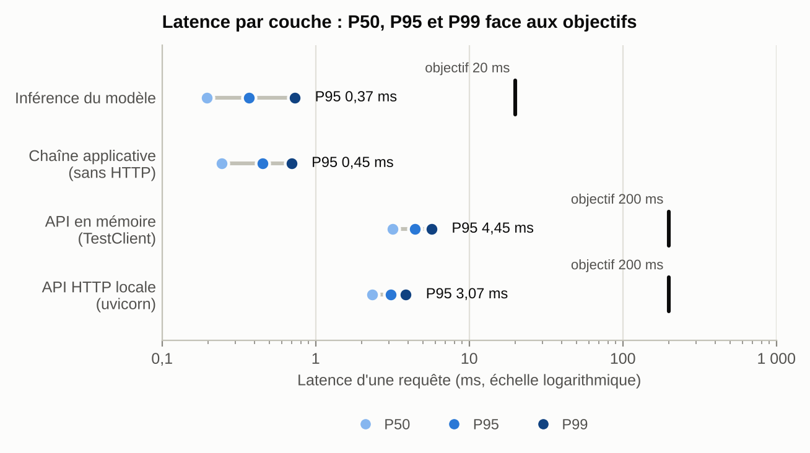
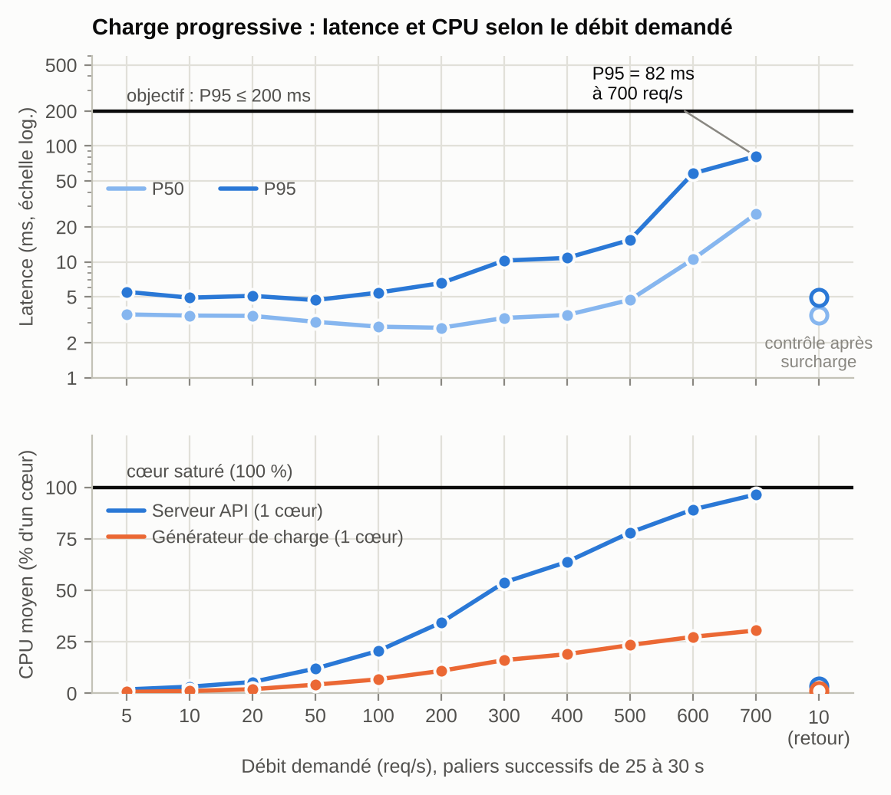

# Rapport de performance : API de prédiction du risque de crédit

Mesures de latence, de débit et de charge progressive du prototype `CreditRisk-Test` (version
0.2.0). **Les données sont synthétiques** : les résultats décrivent le comportement
technique du prototype sur cette machine, pas celui d'un système de production.

## 1. Synthèse

| Id | Indicateur | Objectif | Mesure | Verdict |
| :--- | :--- | :--- | :--- | :--- |
| O1 | Latence d'inférence du modèle, P95 | ≤ 20 ms | 0,37 ms | respecté |
| O2 | Temps de réponse de l'API, P95 (requêtes valides, client unique) | ≤ 200 ms | 3,07 ms | respecté |
| O3 | Débit soutenu avec P95 ≤ 200 ms et aucun échec | ≥ 50 req/s | 686 req/s (essai 2) ; 403 req/s (essai 1) | respecté |
| O4 | Disponibilité après surcharge et retour au niveau initial | aucune erreur serveur ; P95 final ≤ 1,5 × P95 initial | facteur 1,01 ; santé 200 | respecté |

## 2. Objectifs de performance et justification

Le prototype est un outil d'aide à la décision utilisé **en interactif** par un agent de crédit :
il saisit les données du demandeur, lit le niveau de risque et poursuit l'entretien. Les objectifs
découlent de cet usage ; ils ne sont pas déduits de ce que le prototype sait faire.

| Id | Indicateur | Objectif | Justification |
| :--- | :--- | :--- | :--- |
| O1 | Latence d'inférence du modèle, P95 | ≤ 20 ms | Garde-fou : 10 % du budget de l'API. Détecte le remplacement du modèle par un modèle beaucoup plus lourd. |
| O2 | Temps de réponse de l'API, P95, requêtes valides, charge faible | ≤ 200 ms | Repères classiques d'ergonomie (Nielsen, 1993) : sous 0,1 s la réponse paraît instantanée, sous 1 s le fil de l'entretien n'est pas rompu. L'API n'est qu'un maillon (réseau, interface) : on lui alloue au plus 20 % de la seconde. |
| O3 | Débit soutenu avec P95 ≤ 200 ms et aucun échec | ≥ 50 req/s | Hypothèse à confirmer avec le métier : 300 agents, une simulation toutes les 15 s en heure de pointe, soit 20 req/s, avec une marge de ×2,5. |
| O4 | Disponibilité après surcharge | aucune erreur serveur ; retour au niveau initial | Une surcharge ne doit pas laisser le service dégradé : après le pic, le P95 revient à au plus 1,5 × sa valeur initiale. |

Le P95 est retenu plutôt que la moyenne : il décrit l'expérience de 19 agents sur 20, alors que la
moyenne masque les lenteurs. Les valeurs maximales et le P99 sont rapportés à titre d'information.

## 3. Configuration matérielle et logicielle

| Élément | Valeur |
| :--- | :--- |
| Processeur | Intel(R) Xeon(R) Processor @ 2.10GHz (2 100 MHz) |
| Cœurs | 2 logiques, 2 utilisables ; machine virtualisée : oui ; quota CPU : aucun |
| Mémoire vive | 7,8 Go |
| Accélérateur | aucun (inférence sur CPU) |
| Système | Linux-6.18.44-fc-v185-x86_64-with-glibc2.39 (noyau 6.18.44-fc-v185) |
| Python | 3.13.18 (CPython) |
| Serveur | uvicorn, boucle asyncio, analyseur HTTP h11, 1 processus |
| Paquets principaux | fastapi 0.162.0, starlette 1.7.0, uvicorn 0.54.0, numpy 2.5.3, scipy 1.18.1, scikit-learn 1.9.1, joblib 1.6.0, pandas 3.0.5, httpx 0.28.1, locust 2.47.0, pytest 9.1.1 |
| Application | version 0.2.0, modèle 1.0.0 (1,5 Ko), commit 536f953 |
| Date des mesures | 2026-11-02 01:24:10 UTC |

Le serveur est épinglé sur le cœur 0, le client de mesure (ou Locust) sur le cœur
1 : ils ne se disputent pas le même processeur. Tout se passe sur la boucle locale
(127.0.0.1), sans réseau réel, sans TLS ni proxy.

## 4. Méthode

- **Latence d'inférence** : appels répétés (3 000 après 200 d'échauffement) sur 300 profils réalistes du
  jeu d'évaluation synthétique ; durée mesurée avec `time.perf_counter_ns`. Deux niveaux : le modèle
  scikit-learn seul et le service applicatif avec ses contrôles (dimensions, finitude, probabilité).
- **Chaîne applicative** : validation, prétraitement, prédiction, interprétation et alertes, sans HTTP.
- **API en mémoire** : `TestClient` (1 000 requêtes) ; **API HTTP locale** : serveur uvicorn réel, un client
  séquentiel avec connexion persistante (1 500 requêtes après 150 d'échauffement).
- **Percentiles** : interpolation linéaire (numpy). Le P95 est la valeur sous laquelle se situent 95 % des durées.
- **Rafales** : N requêtes écrites au même instant sur N connexions ouvertes (client sans surcoût), 15 rafales
  par taille ; pire cas de « tous les agents valident ensemble ».
- **Débit saturé** : 16 clients enchaînant les requêtes sans pause pendant 10 s ; le CPU du serveur est relevé.
- **Charge progressive (Locust)** : 12 paliers de 25 à 30 s ; chaque utilisateur simulé émet en moyenne une requête par
  seconde avec un temps de réflexion exponentiel (arrivées aléatoires). 95 % de requêtes valides, 5 % invalides
  (réponse 422 attendue). Les 7 premières secondes de chaque palier sont écartées. Un palier est conforme si
  le P95 des requêtes valides respecte l'objectif et si aucune requête n'échoue. Le CPU du serveur et du générateur est relevé chaque seconde.
- **Piège évité** : avec une cadence rigoureusement constante, Locust synchronise les utilisateurs et crée des
  rafales artificielles (essai préliminaire : 50 utilisateurs, P50 ≈ 54 ms au lieu de ≈ 3 ms). Les arrivées sont donc
  aléatoires, et les rafales réelles sont mesurées à part.

## 5. Résultats

### 5.1 Latence par couche

| Couche | n | P50 (ms) | P95 (ms) | P99 (ms) | Max (ms) | Débit séquentiel (req/s) |
| :--- | ---: | ---: | ---: | ---: | ---: | ---: |
| Modèle seul (`predict_proba`) | 3 000 | 0,18 | 0,24 | 0,30 | 1,00 | 5 280 |
| Service de prédiction (avec contrôles) | 3 000 | 0,20 | 0,37 | 0,73 | 1,74 | 4 303 |
| Chaîne applicative (sans HTTP) | 3 000 | 0,24 | 0,45 | 0,70 | 2,13 | 3 652 |
| API en mémoire (TestClient) | 1 000 | 3,18 | 4,45 | 5,70 | 9,76 | 299 |
| API HTTP locale, requête valide | 1 500 | 2,34 | 3,07 | 3,87 | 6,81 | 415 |
| API HTTP locale, `/health` | 500 | 1,40 | 1,90 | 2,20 | 5,50 | 688 |



### 5.2 Débit et rafales

Un client unique qui enchaîne les requêtes obtient 415 req/s
(c'est l'inverse de la latence : le client attend chaque réponse, ce n'est pas la capacité du serveur).
Avec 16 clients concurrents sans pause, le serveur
atteint **637 req/s** avec son cœur à 96 % : c'est le plafond d'un processus
uvicorn dans cette configuration (P95 = 40 ms, 0 échec).

Pire cas, N requêtes strictement simultanées (le serveur les traite l'une après l'autre) :

| Requêtes simultanées | P50 (ms) | P95 (ms) | Max (ms) | Durée de la rafale (ms) | Échecs |
| ---: | ---: | ---: | ---: | ---: | ---: |
| 10 | 11 | 17 | 18 | 12 | 0 |
| 25 | 27 | 41 | 43 | 29 | 0 |
| 50 | 49 | 101 | 106 | 50 | 0 |
| 100 | 102 | 138 | 142 | 105 | 0 |
| 200 | 210 | 277 | 288 | 219 | 0 |

### 5.3 Charge progressive

| Demandé (req/s) | Observé (req/s) | P50 (ms) | P95 (ms) | P99 (ms) | Max (ms) | Échecs | CPU serveur | CPU générateur | P95 ≤ 200 ms |
| ---: | ---: | ---: | ---: | ---: | ---: | ---: | ---: | ---: | ---: |
| 5 | 5,7 | 3,5 | 5,5 | 8,1 | 8,6 | 0 | 2 % | 1 % | oui |
| 10 | 10,4 | 3,4 | 4,9 | 7,4 | 9,7 | 0 | 3 % | 1 % | oui |
| 20 | 19,3 | 3,4 | 5,1 | 8,0 | 31,2 | 0 | 6 % | 2 % | oui |
| 50 | 50,1 | 3,0 | 4,7 | 7,2 | 22,4 | 0 | 12 % | 4 % | oui |
| 100 | 98,4 | 2,8 | 5,4 | 8,7 | 20,4 | 0 | 21 % | 7 % | oui |
| 200 | 190,0 | 2,7 | 6,6 | 30,9 | 68,4 | 0 | 34 % | 11 % | oui |
| 300 | 301,3 | 3,3 | 10,3 | 26,1 | 89,5 | 0 | 54 % | 16 % | oui |
| 400 | 396,6 | 3,5 | 10,8 | 17,3 | 63,3 | 0 | 64 % | 19 % | oui |
| 500 | 497,0 | 4,7 | 15,5 | 27,9 | 82,7 | 0 | 78 % | 23 % | oui |
| 600 | 587,3 | 10,5 | 57,9 | 201,9 | 312,7 | 0 | 89 % | 27 % | oui |
| 700 | 686,1 | 25,9 | 81,5 | 124,0 | 171,6 | 0 | 96 % | 30 % | oui |
| 10 (retour) | 9,9 | 3,5 | 5,0 | 7,5 | 9,4 | 0 | 3 % | 1 % | oui |



Sur l'ensemble de l'essai : 73 632 requêtes, 0 échecs.
Journal du serveur : 0 trace d'erreur, 0 réponse 5xx.
Santé du service après la charge : HTTP 200.

### 5.4 Démarrage et mémoire

Démarrage à froid (lancement du processus jusqu'à la première réponse `/health` positive) :
1,2 s en médiane (1,3, 1,1, 1,2 s). Mémoire résidente du
serveur : 166 Mo avant la charge, 180 Mo après
(180 Mo au pic).

## 6. Interprétation

### 6.1 Les objectifs sont-ils respectés ?

| Id | Indicateur | Objectif | Mesure | Marge | Verdict |
| :--- | :--- | :--- | :--- | :--- | :--- |
| O1 | Latence d'inférence du modèle, P95 | ≤ 20 ms | 0,37 ms | × 55 | **respecté** |
| O2 | Temps de réponse de l'API, P95 (requêtes valides, client unique) | ≤ 200 ms | 3,07 ms | × 65 | **respecté** |
| O3 | Débit soutenu avec P95 ≤ 200 ms et aucun échec | ≥ 50 req/s | 686 req/s (essai 2) ; 403 req/s (essai 1) | × 8,1 | **respecté** |
| O4 | Disponibilité après surcharge et retour au niveau initial | aucune erreur serveur ; P95 final ≤ 1,5 × P95 initial | facteur 1,01 ; santé 200 | — | **respecté** |

- Le **modèle n'est pas le facteur limitant** : l'inférence prend ≈ 0,20 ms, alors qu'une requête HTTP complète coûte
  ≈ 2,3 ms. Le temps passe surtout dans la pile HTTP, la validation et la sérialisation. Cette conclusion
  vaut pour une régression logistique ; elle serait à refaire avec un modèle plus lourd.
- Aux débits d'usage prévisibles (≤ 50 req/s) le P95 reste à quelques millisecondes et le serveur utilise moins de
  15 % d'un cœur : la marge est très large.
- Le **P95 respecte l'objectif de 200 ms sur tout le parcours** (jusqu'à 700 req/s demandés, P95 = 82 ms)
  ; le serveur sature vers 637–686 req/s (cœur à 96 % au dernier palier), le générateur n'utilisant que 30 % de son cœur : la limite observée est bien celle du serveur.
- **Premiers signes de saturation** : le P99 dépasse 200 ms dès 600 req/s demandés (202 ms), alors que le P95 reste à 58 ms ; l'objectif porte sur le P95.
- **Rafales** : si 100 agents valident exactement au même instant, le P95 reste à 138 ms ; à 200 requêtes simultanées il atteint 277 ms. Le serveur ne rejette rien (aucun échec) : il met les requêtes en file et les traite l'une après l'autre. Avec 300 agents, ce cas est très improbable ; c'est une limite à connaître.
- **Retour à la normale** : au palier de contrôle (10 req/s), le P95 est de
  5,0 ms contre 4,9 ms avant la montée en charge
  (facteur 1,01).

### 6.2 Anomalies observées pendant les mesures

1. **Coupures de connexion isolées** : 4 requêtes sur 73 860 (0,005 %) ont échoué lors du premier essai
   complet, contre 0 sur 73 632 lors du second. Statut 0 côté client (connexion fermée avant la réponse),
   aucune trace côté serveur. Cause probable, étayée par une expérience dédiée : uvicorn ferme les connexions inactives après 5 s
   (`--timeout-keep-alive`) ; un client qui réutilise la connexion à environ 5,00 s d'inactivité reçoit une
   réinitialisation ou une fermeture (5 essais sur 5 réussis à 4,97 s, 5 sur 5 en échec à 5,03 s, mélange à 5,00 s). Ce lien n'est
   pas prouvé pour les 4 cas observés. Gravité mineure : à traiter par un délai plus long côté serveur et une relance
   côté client (`POST /predict` est sans effet de bord).
2. **Piège de mesure** : lors d'un essai préliminaire (`essai_preliminaire_cadence_constante.txt`), une cadence strictement
   constante a synchronisé les utilisateurs Locust : avec 50 utilisateurs, le P50 atteignait 54 ms contre ≈ 3 ms avec des
   arrivées aléatoires. Ce n'est pas une anomalie du produit, mais une erreur d'interprétation qui aurait faussé le verdict.

### 6.3 Limites de la mesure

- Machine virtuelle de 2 cœurs partagée entre le serveur et le générateur ; bruit d'ordonnancement non maîtrisé.
- Boucle locale : pas de latence réseau, de TLS, de proxy inverse ni d'authentification.
- Modèle volontairement simple, données synthétiques, profils tirés du jeu d'évaluation.
- Paliers courts (≈ 20 s mesurées) : aux faibles débits l'échantillon est petit (≈ 100 requêtes à 5 req/s), donc le P99 est peu fiable.
  Pas de test d'endurance (fuite mémoire, dérive) ni de test sur plusieurs processus.
- Les objectifs reposent sur des hypothèses d'usage non confirmées par un métier réel.
- Deux exécutions complètes seulement (section 7) : la dispersion près de la saturation n'est pas estimée statistiquement.

### 6.4 Recommandations

1. Conserver O1 à O3 comme garde-fous de non-régression et ajouter une alerte relative (par exemple +50 % du P95 de référence) :
   avec des marges de ×8 à ×65, une régression sérieuse resterait invisible face aux seuils absolus.
2. En exploitation : `uvicorn[standard]` (uvloop, httptools), plusieurs processus (un par cœur), `--timeout-keep-alive` supérieur
   à l'inactivité des clients, relance côté client.
3. Rejouer cette campagne sur le matériel cible, avec réseau, TLS et authentification, puis réaliser un test d'endurance d'une heure.
4. Confirmer avec le métier le nombre d'agents et la cadence de pointe ; en déduire un nouvel objectif O3 si l'hypothèse change.

## 7. Répétabilité

Deux exécutions complètes de la charge progressive (mêmes paliers, même machine) :

| Demandé (req/s) | P95 essai 1 (ms) | P95 essai 2 (ms) | Débit essai 1 | Débit essai 2 |
| ---: | ---: | ---: | ---: | ---: |
| 5 | 5,4 | 5,5 | 4 | 6 |
| 10 | 5,2 | 4,9 | 11 | 10 |
| 20 | 5,2 | 5,1 | 19 | 19 |
| 50 | 4,6 | 4,7 | 50 | 50 |
| 100 | 4,5 | 5,4 | 96 | 98 |
| 200 | 5,8 | 6,6 | 200 | 190 |
| 300 | 9,4 | 10,3 | 299 | 301 |
| 400 | 11,6 | 10,8 | 403 | 397 |
| 500 | 31,3 | 15,5 | 499 | 497 |
| 600 | 57,0 | 57,9 | 595 | 587 |
| 700 | 90,6 | 81,5 | 674 | 686 |

Les ordres de grandeur sont stables. Les écarts les plus nets apparaissent près de la saturation, où le temps d'attente
est très sensible au moindre aléa : c'est un argument supplémentaire pour fixer des objectifs avec une large marge.

## 8. Reproduire les mesures

```bash
pip install -r requirements-perf.txt
python -m scripts.benchmark_performance            # micro-mesures (≈ 1,5 min)
python -m scripts.benchmark_performance charge     # charge progressive Locust (≈ 5,5 min)
python -m scripts.benchmark_performance rapport    # figures et ce document
```

Les résultats bruts sont dans `reports/performance/` : `performance.json`, `charge_par_palier.csv`,
`charge_par_seconde.csv`, `charge_cpu_par_seconde.csv`, `locust_stats.csv`.
